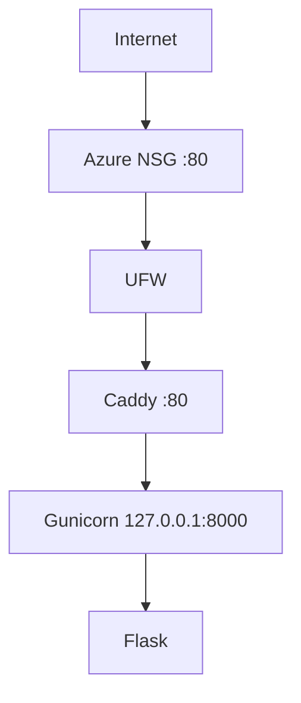
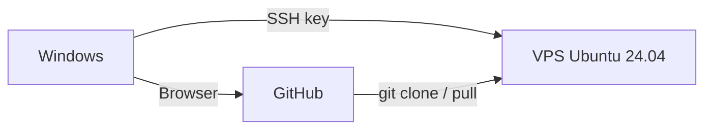

# Architecture v0.1

## Deployment View

## Client - Repository - VPS

## Resource Constraints
- 2 vCPU, sekitar 1 GB RAM, swap 1 GB
- Disk 64 GiB
- Gunicorn 1 worker, 2 thread

## Security Decisions
- Administrasi memakai user non-root
- SSH key authentication (Ed25519)
- Password SSH dan root SSH dinonaktifkan
- UFW aktif, hanya port 22 dan 80
- Azure NSG hanya membuka port yang diperlukan
- Backend loopback-only
- GitHub deploy key khusus satu repository

## Current Limitations
- HTTP only
- Single VPS
- Data contoh tertulis di kode, belum ada database
- Belum ada container
- Belum ada CI/CD
- Deployment manual

## Planned Evolution
- M04 DNS + HTTPS
- M05 persistent data (siswa, tempat PKL, jurnal)
- M06 container
- M07 IaC
- M09 CI/CD
